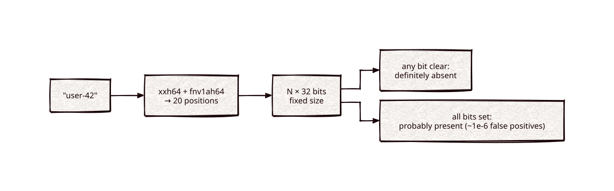

# bloom-filter

[](https://github.com/Kronuz/bloom-filter/actions/workflows/ci.yml)
[](LICENSE)


A fixed-size Bloom filter for C++20: answer "have I seen this key?" with no false
negatives and about one false positive in a million, in memory that does not
grow with the data. For skipping expensive lookups when the answer is no.



## ✨ Highlights

- **No false negatives.** A key that was added always reads back present.
- **About 1e-6 false positives** at the design load: `N × 32` bits and 20 probes.
- **Fixed footprint.** `BloomFilter<N>` is a `4 × N`-byte object; the default
  `N = 131072` is 512 KiB.
- **Salted views.** A non-zero salt gives an independent filter over the same
  bits.
- **One header**, hashing with [hashes](https://github.com/Kronuz/hashes)'
  `xxh64` and `fnv1ah64`.

## 📦 Installation

Requires a C++20 compiler and CMake 3.14 or newer; it fetches hashes. CI builds it
on Linux (x86_64, arm64), macOS (arm64, x86_64), and FreeBSD, plus ASan, UBSan,
and TSan builds.

```cmake
include(FetchContent)
FetchContent_Declare(bloom_filter
  GIT_REPOSITORY https://github.com/Kronuz/bloom-filter.git
  GIT_TAG        main)
FetchContent_MakeAvailable(bloom_filter)

target_link_libraries(my_app PRIVATE bloom_filter::bloom_filter)
```

## 🚀 Quick start

```cpp
#include "bloom_filter.hh"

#include <memory>
#include <string>

int main() {
	auto seen = std::make_unique<BloomFilter<8192>>();   // 32 KiB; large ones belong on the heap

	std::string key = "user-42";
	seen->add(key.data(), key.size());
	bool hit = seen->contains(key.data(), key.size());   // true, always
	bool miss = seen->contains("other", 5);              // false, almost always
}
```

[`examples/usage.cc`](examples/usage.cc) is a runnable usage example.

## 🎯 When to use it

- ✅ A cheap "definitely not there" in front of a disk read, a network call, or a
  big table.
- ❌ Removing keys: a Bloom filter cannot delete without causing false negatives.
- ❌ A static key set built once: [fusefilter](https://github.com/Kronuz/fusefilter)
  answers the same question in fewer bits per key.

## 📚 Documentation

- [docs/API.md](docs/API.md): `add`, `contains`, sizing, and salts.
- [ARCHITECTURE.md](ARCHITECTURE.md): how the probe positions are derived.
- [AGENTS.md](AGENTS.md): repository map and invariants.

## 🛠️ Building and testing

```sh
cmake -B build && cmake --build build && ctest --test-dir build
```

## 🤝 Contributing

Issues and pull requests are welcome. Read [AGENTS.md](AGENTS.md) first. CI must
pass on every platform.

## 📄 License

MIT, Copyright (c) 2018, 2019 Dubalu LLC. See [LICENSE](LICENSE). Extracted from
[Xapiand](https://github.com/Kronuz/Xapiand).
